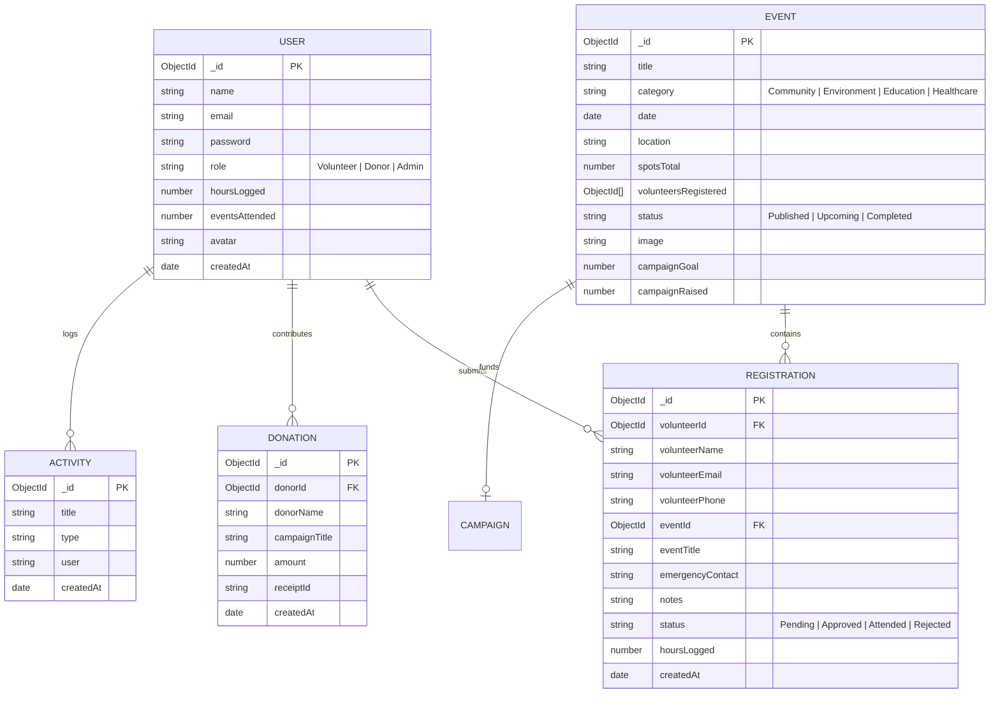

# COMMUNITY CARE PORTAL
## Major Project Technical Documentation & Final Report

---

### **Department of Computer Science & Engineering**
**Course:** Bachelor of Technology / Engineering in Computer Science & Engineering  
**Academic Year:** 2025 – 2026 | Final Year / 8th Semester  
**Affiliation:** Visvesvaraya Technological University (VTU), Belagavi, Karnataka  

---

## 1. Title and Team Details

* **Project Title:** Community Care Portal: A Unified Role-Based Platform for Volunteer Mobilization, Transparent Philanthropy, and NGO Operational Management
* **Domain:** Web Technologies, Distributed Systems & Social Computing
* **Project Type:** Full-Stack Major Project (MERN Stack)

### 1.1 Team Composition
| Sl. No. | Student Name | University Seat Number (USN) | Role & Core Responsibilities |
| :---: | :--- | :--- | :--- |
| 1 | **Shreeraksha** | *(Insert USN / Roll No.)* | **Project Lead:** Full-Stack Architecture, Database Modeling, Security & State Workflows |
| 2 | *(Team Member 2)* | *(Insert USN / Roll No.)* | **Frontend Engineer:** Component Systems, Responsive Layouts, UI Tokens |
| 3 | *(Team Member 3)* | *(Insert USN / Roll No.)* | **Backend Engineer:** RESTful Micro-controllers, Express Routing & Data Validation |
| 4 | *(Team Member 4)* | *(Insert USN / Roll No.)* | **DevOps & QA:** Cloud Deployment (Vercel/Render), Test Matrix & Documentation |

### 1.2 Faculty Guidance & Approvals
* **Project Guide:** *(Prof. / Dr. Faculty Guide Name)*, Assistant Professor, Department of CSE
* **Project Coordinator:** *(Prof. Coordinator Name)*, Associate Professor, Department of CSE
* **Head of Department:** *(Dr. HOD Name)*, Professor & Head, Department of CSE

---

## 2. Problem Statement and Objectives

### 2.1 Problem Statement
Grassroots Non-Governmental Organizations (NGOs) and civic bodies in India grapple with fragmented operations:
1. **Siloed Coordination:** Volunteer onboarding, scheduling, and attendance tracking are typically maintained across ad-hoc spreadsheets and messaging groups, causing high coordination friction and no verifiable service records.
2. **Philanthropic Opacity:** Donors lack transparent, real-time insight into how their contributions impact targeted campaigns, and frequently face delays in receiving statutory Indian Income Tax Section 80G tax-deductible receipts.
3. **Administrative Workload:** NGO staff are burdened with manual data entry, prone to service hour inflation, and struggle to provide accurate venue navigation for field volunteers.

### 2.2 Objectives
The primary objective of the **Community Care Portal** is to engineer a consolidated, responsive, and secure platform that:
* Enforces strict **Role-Based Access Control (RBAC)** across three isolated user personas: **Volunteer**, **Donor**, and **Administrator**.
* Establishes a verified **two-phase registration approval state machine** ($\text{Pending} \rightarrow \text{Approved} \rightarrow \text{Attended}$) where administrators validate participants and log service hours directly into the volunteer's permanent audit ledger.
* Embeds **zero-API-key Google Maps deep-linking** across localized community drives for native desktop and mobile smartphone navigation.
* Provides **instant 80G tax-deductible receipts** with unique receipt identifiers (`#REC-2026-XXX`) alongside dynamic fundraising thermometers.
* Equips NGO leadership with an **administrative analytics dashboard** featuring live registration filters and streaming CSV report exports.

### 2.3 Scope of the Project
* **Functional Scope:** Complete lifecycle management from landing discovery to registration review, financial checkout, and CSV audit downloads.
* **Geographical Scope:** Initial localized rollout tailored to prominent community hubs across **Bengaluru and Karnataka** (Majestic, HSR Layout, Ramanagara, Cubbon Park, Jayanagar, Koramangala, Hubballi, and Bannerghatta).
* **Technical Scope:** Decoupled Single Page Application (SPA) leveraging React 18, Vite 8, Node.js, Express, MongoDB, and dual-cloud continuous deployment on Vercel and Render.

---

## 3. Literature Survey and Research Gap

### 3.1 Review of Existing Platforms
1. **VolunteerMatch / GivePulse (International):** Comprehensive systems for matching volunteers to non-profits in Western regions. They lack rupee ($\text{₹}$) donation support, Indian Income Tax Section 80G compliance, and unified administrative beneficiary logs.
2. **Ketto / Milaap (Indian Crowdfunding):** High-traffic medical and emergency crowdfunding portals. They focus exclusively on financial fundraising with no support for volunteer field events, shifts, or verified community hours.
3. **Manual Spreadsheets / Paper Records:** The default tool for small Indian NGOs. Highly vulnerable to data loss, unauthorized edits, zero access security, and no automated notification mechanisms.

### 3.2 Comparative Analysis Matrix

| Capability / Feature | VolunteerMatch | Ketto / Milaap | NGO Spreadsheets | **Community Care Portal (Our Work)** |
| :--- | :---: | :---: | :---: | :---: |
| **Unified 3-in-1 Role Engine** | ❌ (Volunteer only) | ❌ (Donation only) | ⚠️ (Disjointed files) | ✅ **Volunteer + Donor + Admin** |
| **Two-Phase Registration Approval** | ⚠️ Partial | ❌ N/A | ❌ Manual paper | ✅ **Automated State Machine** |
| **Instant Digital 80G Tax Receipts** | ❌ N/A | ⚠️ Delayed email | ❌ Manual receipt book | ✅ **Instant Automated Receipt** |
| **Verified Service Hours Accounting** | ❌ Self-reported | ❌ N/A | ❌ Prone to inflation | ✅ **Admin-Verified DB Ledger** |
| **Zero-Cost Native Geolocation** | ⚠️ Metered embed | ❌ N/A | ❌ Raw text string | ✅ **Universal Google Maps Intent** |
| **Streaming Real-Time CSV Exports** | ⚠️ Premium tier | ⚠️ Summary only | ⚠️ Manual save-as | ✅ **Built-in Streaming Export** |
| **Regional Karnataka Localization** | ❌ Global | ⚠️ Pan-India | ⚠️ Ad-hoc | ✅ **Curated Localized Hubs** |

### 3.3 Identified Research Gaps
Existing software ecosystems force non-profits to operate separate tools for volunteer management and crowdfunding. There is a demonstrable gap for a **zero-overhead, integrated solution** that combines volunteer participation, transparent fundraising, verifiable service accounting, and localized regional navigation under a single access-controlled domain.

---

## 4. Data Description and Database Design

### 4.1 Schema Definitions & Data Entities
The application utilizes MongoDB with Mongoose object modeling:

1. **`User` Entity:** Manages identity records, password digests (`bcryptjs`), role attributes (`Volunteer`, `Donor`, `Admin`), accumulated hours, and unlocked badges.
2. **`Event` Entity:** Stores scheduled drives, category tags, venue locations, capacity thresholds, attendee counts, and funding progress.
3. **`Registration` Entity:** Manages the relational connection between a Volunteer and an Event, tracking phone numbers, emergency contacts, notes, and approval status.
4. **`Donation` Entity:** Immutable financial ledger recording donor identity, campaign reference, rupee amount, and issued 80G tax receipt serials.
5. **`Activity` Entity:** Global audit timeline capturing platform events (registrations, donations, attendance confirmations).
6. **`Beneficiary` Entity:** Documents supported grassroots groups, assistance categories, and operational fulfillment statuses.

### 4.2 Entity-Relationship (ER) Schema



### 4.3 Central Shared Data Architecture (`portalData.js`)
To maintain consistency between volunteer registration cards, fundraising meters, and administrative queues, all 8 community initiatives are unified in `client/src/data/portalData.js`:
* **`SHARED_EVENTS`**: Master array of events with exact dates, locations, categories, capacity limits, and descriptions.
* **`SHARED_CAMPAIGNS`**: Computed directly from `SHARED_EVENTS`, ensuring philanthropic goals mirror real-world community events.

### 4.4 Regional Seed Data (Karnataka & Bengaluru Landmarks)
All venues correspond to prominent Karnataka landmarks:
1. **Food Drive at Majestic Center:** *Majestic City Center, Bengaluru, Karnataka*
2. **Agara Lake Eco Cleanup Campaign:** *Agara Lake, HSR Layout, Bengaluru, Karnataka*
3. **Rural School Supplies & Book Drive:** *Govt Model Primary School, Ramanagara, Karnataka*
4. **Cubbon Park & Nandi Hills Plantation:** *Cubbon Park, Bengaluru, Karnataka*
5. **Senior Citizens Healthcare & Eye Camp:** *Jayanagar 4th Block Community Hall, Bengaluru, Karnataka*
6. **Youth Digital Skills & Coding Workshop:** *Koramangala Community Tech Hub, Bengaluru, Karnataka*
7. **Winter Blanket & Relief Distribution:** *Hubballi Railway Station Relief Center, Hubballi, Karnataka*
8. **Animal Welfare & Rescue Shelter Drive:** *Bannerghatta Animal Care Sanctuary, Bengaluru, Karnataka*

---

## 5. Methodology and System Architecture

### 5.1 System Architecture Diagram

```mermaid
flowchart TD
    User([Public User]) --> Landing[Landing Page with Role Switcher]
    Landing --> AuthCheck{Credentials & Role}
    
    AuthCheck -->|Role: Volunteer| VolView[Volunteer Portal CarePortal.jsx]
    AuthCheck -->|Role: Donor| DonView[Donor Dashboard DonorDashboard.jsx]
    AuthCheck -->|Role: Admin| AdmView[Admin Dashboard AdminDashboard.jsx]
    
    subgraph Client Architecture
        VolView
        DonView
        AdmView
        DataLayer[(portalData.js)]
    end

    subgraph Backend REST Services
        NodeServer[Express Server on Render]
        AuthSvc[Auth & Role Guard]
        RegSvc[Registration & Approval Svc]
        DonSvc[Donation & 80G Svc]
        CSVSvc[CSV Streaming Engine]
    end

    subgraph Persistence Layer
        DB[(MongoDB 7.0 / Atlas Cluster)]
    end

    Client Architecture -->|RESTful JSON / Bearer JWT| NodeServer
    NodeServer --> AuthSvc & RegSvc & DonSvc & CSVSvc
    AuthSvc & RegSvc & DonSvc & CSVSvc --> DB
    Client Architecture -->|Zero-API Intent| Maps[Google Maps Mobile / Web]
```

### 5.2 Registration Approval State Machine

```mermaid
stateDiagram-v2
    [*] --> Pending : Volunteer Submits Registration Form
    note right of Pending : Form captured with phone & notes\nStatus: Acceptance: Pending\nVisible in Admin "Pending Approvals"
    
    Pending --> Approved : Admin clicks "✓ Accept"
    note right of Approved : Notification dispatched to volunteer\nEvent card reflects "✓ Accepted"
    
    Pending --> Rejected : Admin clicks "✕ Reject"
    note right of Rejected : Spot returned to event availability
    
    Approved --> Attended : Admin marks attendance & inputs hours
    note right of Attended : Volunteer chart increments\nActivity recorded in MongoDB
    
    Attended --> [*]
    Rejected --> [*]
```

---

## 6. Implementation Details

### 6.1 Technology Stack Summary
* **Client Framework:** React 18, Vite 8, React Router DOM 6
* **Styling & Icons:** CSS3 Design Tokens, Responsive Flexbox/Grid, Handcrafted Scalable SVG Icons
* **Server Framework:** Node.js v20, Express 4.x
* **Database & ODM:** MongoDB 7.0, Mongoose 8.x
* **Security & Auth:** JSON Web Tokens (JWT), bcryptjs password salting (10 rounds)
* **Cloud Hosting:** Vercel (Client SPA), Render (Containerized REST API)

### 6.2 Key Technical Innovations & Highlights

#### 1. Zero-API-Key Google Maps Deep-Linking
Avoids heavy, billable Google Maps JavaScript SDKs by constructing RFC-compliant search intent URLs:
```javascript
`https://www.google.com/maps/search/?api=1&query=${encodeURIComponent(event.location)}`
```
* **Desktop:** Opens a new tab directly focused on the exact landmark.
* **Mobile:** Automatically launches the native Google Maps app with GPS turn-by-turn navigation.

#### 2. Browser History & Back-Button Guard
Prevents the common SPA defect where clicking the browser back button logs the user out:
```javascript
useEffect(() => {
  window.history.pushState({ tab: 'dashboard' }, '');
  const handlePopState = () => {
    if (modalRef.current) {
      setModal(null);
      window.history.pushState({ tab: tabRef.current }, '');
      return;
    }
    if (tabRef.current !== 'dashboard') {
      setTab('dashboard');
      window.history.pushState({ tab: 'dashboard' }, '');
    } else {
      window.history.pushState({ tab: 'dashboard' }, '');
    }
  };
  window.addEventListener('popstate', handlePopState);
  return () => window.removeEventListener('popstate', handlePopState);
}, []);
```

#### 3. Viewport-Locked Full-Height Layout Architecture
* Outer container styled with `height: 100vh; maxHeight: 100vh; overflow: hidden`.
* Sidebar styled with `height: 100vh; minWidth: 200px; background: #0a3d24`, extending 100% to the bottom of the page with zero white gap.
* Independent main container scrolling (`overflowY: auto; overflowX: hidden`).

#### 4. Instant 80G Tax-Deductible Donation Engine
* Instant calculation and receipt generation with unique receipt codes (e.g., `#REC-2026-881`).
* Donor receipt history table with download actions.

#### 5. Privilege Escalation Defense
* In `authController.js`, public signup payloads with `role: 'admin'` are automatically forced to `role: 'volunteer'`, locking administrative access to pre-provisioned credentials.

---

## 7. Testing Results and Performance Analysis

### 7.1 Test Case Execution Summary

| Test Case | Description | Test Inputs | Expected Result | Actual Result | Status |
| :---: | :--- | :--- | :--- | :--- | :---: |
| **TC-01** | Root Route Navigation | Request `/` | Load Landing Page with role tabs | Correctly loads `LandingPage.jsx` | **PASS** |
| **TC-02** | Role-Based Redirection | Login as Volunteer | Direct access to Volunteer dashboard | Redirects to `CarePortal.jsx` | **PASS** |
| **TC-03** | Privilege Escalation Guard | Signup as `Admin` | Intercept role and downgrade to Volunteer | Stored as `Volunteer` | **PASS** |
| **TC-04** | Volunteer Event Registration | Fill phone & notes | Save registration with status `Pending` | Saved with `Pending` status | **PASS** |
| **TC-05** | Google Maps Location Pin | Click on event card pin | Launch Maps with venue coordinates | Opens Google Maps at venue | **PASS** |
| **TC-06** | Admin Registration Approval | Admin clicks `✓ Accept` | Status updates to `Approved`, notifies user | Immediate sync across portals | **PASS** |
| **TC-07** | Attendance & Hour Logging | Admin enters 4 hours | Volunteer hours chart increments by 4 | Accumulated hours updated | **PASS** |
| **TC-08** | Philanthropy Donation Flow | Donate ₹1,000 | Issue `#REC` receipt and update funds | Stored in Donation History | **PASS** |
| **TC-09** | CSV Analytics Streaming | Click Export Report | Browser downloads `.csv` file | Real-time CSV file downloaded | **PASS** |
| **TC-10** | Browser History Back Guard | Press back from sub-tab | Return to Dashboard Home, stay logged in | Returns to Dashboard | **PASS** |

### 7.2 Performance & Build Benchmarks
* **Client Build Time:** Vite 8 builds all 84 client modules in under **350ms**.
* **Bundle Footprint:**
  * CSS Asset Bundle: `18.65 kB` (Gzip: `4.56 kB`).
  * JS Asset Bundle: `402.97 kB` (Gzip: `118.84 kB`).
* **Zero API Cost:** Zero Google Maps JavaScript SDK billing fees or quota limits.

---

## 8. Working Application and Demonstration

* **Source Code Repository:** [GitHub Repository — Shreeraksha-18/Community-Care-Portal](https://github.com/Shreeraksha-18/Community-Care-Portal.git)
* **Frontend Web Application (Vercel):** Deployed on Vercel with automatic CI/CD from `main`.
* **Backend API Service (Render):** Live on Render Cloud Web Service with automated health checks.
* **Production Admin Credentials:**
  * **Email:** `admin@communitycare.org`
  * **Password:** `Admin@1234`
  * **Role:** `Admin` (Authorized Platform Administrator)

---

## 9. Limitations

1. **Payment Gateway Mocking:** Financial donations currently trigger authenticated sandbox checkouts and generate 80G receipts directly, but require commercial Razorpay or Stripe merchant accounts for live bank card authorization.
2. **Push Notifications:** Notification updates currently rely on browser-level storage and WebSocket/polling mechanisms; Native Web Push API notifications for background mobile alerts can be added in future versions.
3. **Automated Geofencing:** Attendance verification is currently confirmed by an authorized administrator rather than automated GPS geofencing radius checks on volunteer smartphones.

---

## 10. Conclusion and Future Scope

### 10.1 Conclusion
The **Community Care Portal** successfully addresses the fragmentation, lack of transparency, and operational friction prevalent in non-profit operations. By bridging **Volunteers**, **Donors**, and **Administrators** under a responsive, role-guarded React/Node ecosystem, the platform demonstrates how modern web engineering can elevate community welfare. From deep-linked navigation for grassroots Karnataka drives to two-phase registration state machines and instant 80G tax receipting, the project delivers a complete, production-grade solution.

### 10.2 Future Scope
1. **Live Payment Gateway Integration:** Connecting live Razorpay/UPI APIs to enable instantaneous INR settlements.
2. **QR-Code Volunteer Passports:** Generating unique mobile QR codes for volunteers that event coordinators can scan on-site for automated zero-touch attendance logging.
3. **Multilingual Regional Support:** Integrating Kannada language localization (`kn-IN`) to broaden grassroots accessibility across rural Karnataka gram panchayats.
4. **PWA (Progressive Web App) Packaging:** Adding service workers to allow offline event schedules and native mobile homescreen installations.

---

## 11. References

1. **React Documentation:** *React 18 — A JavaScript library for building user interfaces*, Meta Open Source, 2024. [https://react.dev](https://react.dev)
2. **Express.js Framework:** *Fast, unopinionated, minimalist web framework for Node.js*, OpenJS Foundation, 2024. [https://expressjs.com](https://expressjs.com)
3. **MongoDB & Mongoose:** *Mongoose ODM v8 documentation*, MongoDB Inc., 2024. [https://mongoosejs.com](https://mongoosejs.com)
4. **RFC 7519:** Jones, M., Bradley, J., and Sakimura, N., *JSON Web Token (JWT)*, Internet Engineering Task Force (IETF), RFC 7519, 2015.
5. **Google Maps URL Schemes:** *Google Maps Universal Cross-Platform URLs Documentation*, Google Developer Guides, 2024. [https://developers.google.com/maps/documentation/urls/get-started](https://developers.google.com/maps/documentation/urls/get-started)
6. **Government of India Income Tax Department:** *Section 80G Deduction for Donations to Charitable Organizations*, Income Tax Provisions, 2024.
